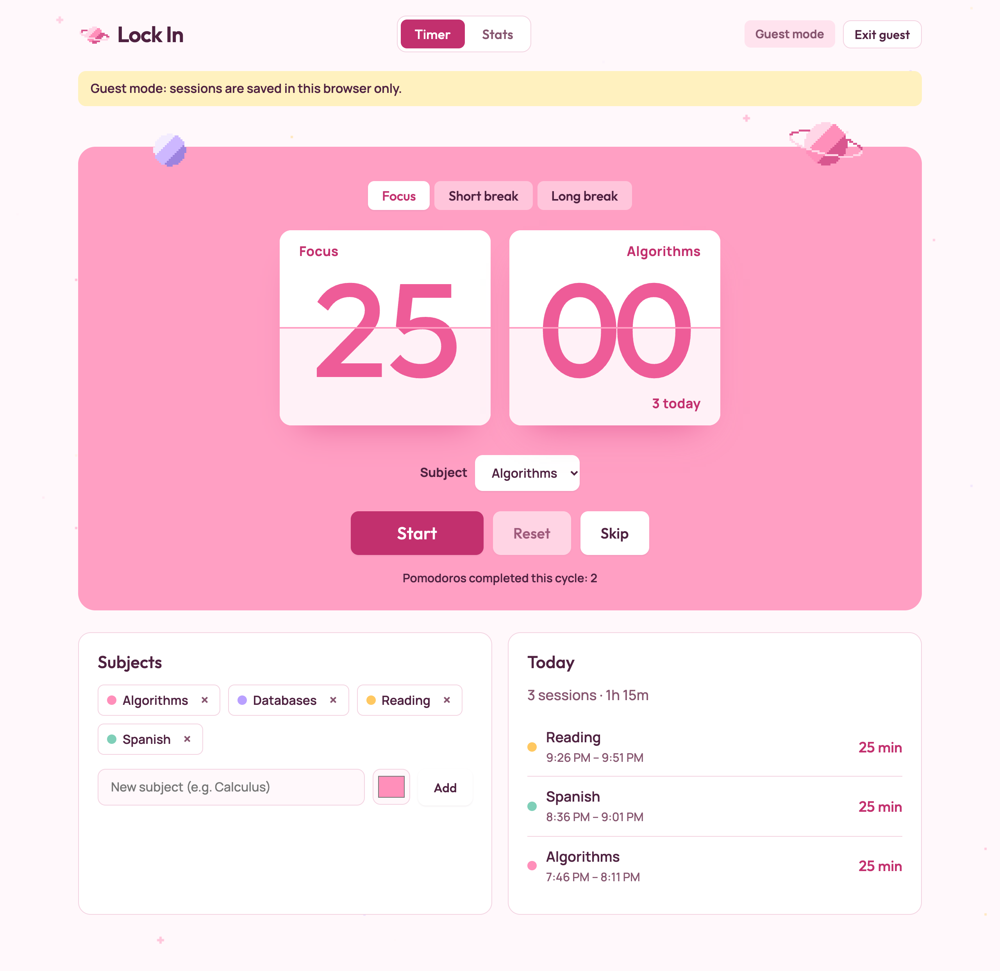
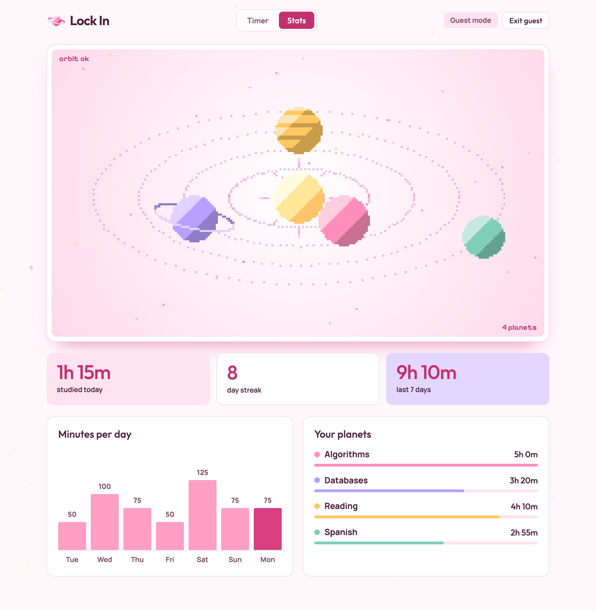
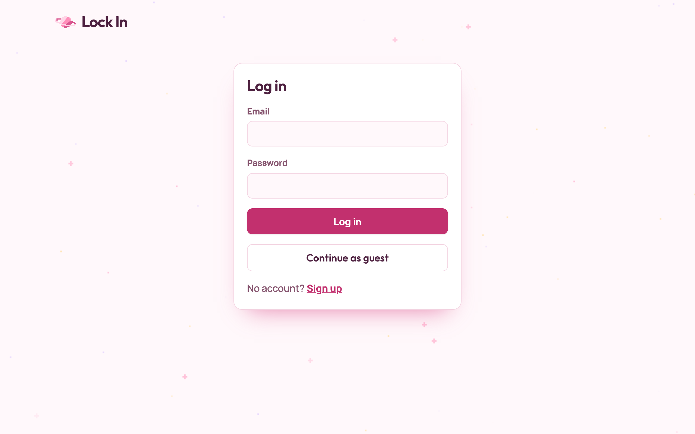
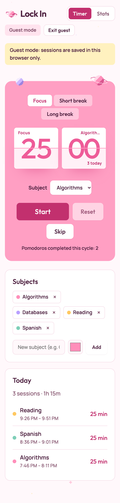

# Lock In

A Pomodoro study timer that tracks what you studied and when. Pick a subject, run focus sessions on a flip-clock timer, and see your history as a pixel-art solar system where every subject is a planet.

**Live demo:** https://lock-in-dashboard.onrender.com (try it without an account: choose **Continue as guest**)

> Hosted on Render's free plan, so the first visit after a quiet spell can take up to a minute to wake up.

## Screenshots

| Timer | Stats |
| --- | --- |
|  |  |

| Login | Mobile |
| --- | --- |
|  |  |

## Features

- **Pomodoro timer**: 25-minute focus, 5-minute short break and 15-minute long break (after every 4 focus sessions). Pause, resume, reset and skip.
- **Survives refreshes**: timer state lives in `localStorage` as an absolute end time, so reloading or closing the tab doesn't lose progress. A session that finished while the page was closed is logged on the next visit.
- **Subjects**: create color-coded subjects and tag each focus session with one.
- **Today's sessions**: a running log of what you finished today, with total time.
- **Stats**: time studied today, day streak, last 7 days, a minutes-per-day bar chart, and an animated pixel orbit where planet size reflects time spent per subject.
- **Accounts or guest mode**: sign up with email and password (JWT auth), or try it as a guest with data kept in the browser only.
- **Accessible**: keyboard focus rings, AA text contrast, and `prefers-reduced-motion` support (no flip animation or twinkling).

## Tech stack

| Layer | Tech |
| --- | --- |
| Client | React 19, React Router 7, Vite; plain CSS with design tokens; canvas pixel art |
| Server | Node.js (22.9+), Express 5, `pg`, bcrypt, jsonwebtoken |
| Database | PostgreSQL 16 (Docker locally; any hosted Postgres such as Neon in production) |
| Tests | Vitest + Testing Library (client timer hook) |
| Hosting | One Render web service that serves both the API and the built client |

## Project structure

```
client/          React app (Vite)
server/          Express API; in production it also serves client/dist
server/db/       schema.sql
docs/design/     HTML design mock for the UI
render.yaml      Render blueprint
```

## Local setup

Requirements: Node.js 22.9 or newer, and Docker.

1. **Start Postgres.** The schema loads automatically the first time the volume is created.

   ```bash
   docker compose up -d
   ```

   This runs Postgres 16 on `localhost:5433` (user, password and database are all `lockin`).

2. **Configure the server.**

   ```bash
   cp server/.env.example server/.env
   # then set JWT_SECRET to a long random string, e.g. `openssl rand -hex 32`
   ```

3. **Install dependencies and load the schema.** The schema script is safe to run any number of times; every statement uses `IF NOT EXISTS`.

   ```bash
   npm install --prefix server
   npm install --prefix client
   npm run db:schema
   ```

4. **Run the dev servers** in two terminals:

   ```bash
   npm run dev --prefix server   # API on http://localhost:4000 (restarts on change)
   npm run dev --prefix client   # app on http://localhost:5173, proxies /api to :4000
   ```

   Open http://localhost:5173. To make every timer "minute" last one second while testing, start the client with `VITE_FAST_TIMER=1 npm run dev --prefix client`.

5. **Run the tests.**

   ```bash
   npm test --prefix client
   ```

### Run the production build locally

```bash
npm run build
NODE_ENV=production npm start   # site and API both on http://localhost:4000
```

## Environment variables

For local development the server reads `server/.env`, then `.env.local` in the repo root (written by `neon deploy`), with `.env.local` taking precedence. Real environment variables override both. To go back to the local Docker database, rename or delete `.env.local`.

| Variable | Required | Description |
| --- | --- | --- |
| `DATABASE_URL` | Yes | Postgres connection string. Hosts other than `localhost` automatically connect with SSL (`rejectUnauthorized: false`, as Neon needs). |
| `DATABASE_URL_UNPOOLED` | No | Direct (non-pooler) Neon connection string. When set, `npm run db:schema` uses it, since schema changes shouldn't go through the pooler. |
| `JWT_SECRET` | Yes | Secret used to sign login tokens. The server refuses to start without it. |
| `NODE_ENV` | In production | Set to `production` to serve the built client from `client/dist`. |
| `PORT` | No | Port to listen on. Defaults to `4000`; Render sets it for you. |
| `CLIENT_ORIGIN` | No | Only needed if the client is hosted on a different origin from the API; enables CORS for that origin. |

## Deploying to Render

The app deploys as a single web service: Express serves the API under `/api` and the built React app for every other route.

1. Create a Postgres database. With [Neon](https://neon.com), link the project and pull its connection strings into `.env.local`:

   ```bash
   npx neon@latest init -y --org-id <org-id> --project-id <project-id> --branch production --services postgres
   npx neon@latest deploy
   ```

2. Load the schema into it once from your machine (reads `.env.local`):

   ```bash
   npm run db:schema
   ```

3. In Render, choose **New → Blueprint** and select this repository. Render reads `render.yaml`, which sets:
   - Build command: `npm run build`
   - Start command: `npm start`
   - `NODE_ENV=production`
   - Health check: `/api/health`
4. When prompted, enter `DATABASE_URL` (the **pooled** Neon string, the one with `-pooler` in the hostname, i.e. `DATABASE_URL` from `.env.local`) and `JWT_SECRET` (use a long random string such as `openssl rand -hex 32`).
5. When the deploy finishes, open the service URL.

## License

No license has been chosen yet.
